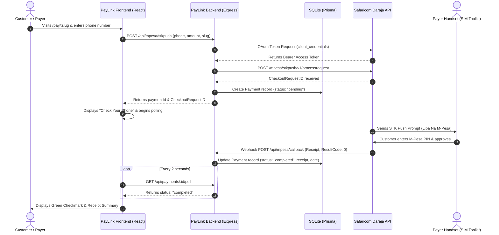

# 🚀 PayLink - M-Pesa Payment Link Generator

[](https://nodejs.org/)
[](https://react.dev/)
[](https://vitejs.dev/)
[](https://www.prisma.io/)
[](https://tailwindcss.com/)
[](#)

**PayLink** is a full-stack web application designed for freelancers, creators, event organizers, and businesses across Kenya to generate custom, shareable payment links with pre-filled amounts and descriptions, and accept instant payments via **Safaricom M-Pesa STK Push (Lipa Na M-Pesa Online)**.

---

## 💡 The Problem & Solution

* **The Problem:** Freelancers and small businesses often tell clients to manually send money by dialing `*334#`, typing in a phone or Paybill number, and entering the amount manually. This leads to amount typos, wrong reference numbers, missing payments, and tedious manual follow-ups.
* **The Solution:** With PayLink, the creator generates a branded link (e.g. `paylink.app/pay/logo-design`) with the exact amount (e.g. KES 15,000) and invoice description locked in. The client opens the link on their phone or desktop, enters their Safaricom phone number, and confirms the payment via an instant M-Pesa STK prompt on their handset.

---

## 🔄 Payment Architecture & Flow



---

## ✨ Features

### 1. 🔗 Custom Payment Link Generator (`/create`)
- Create payment links with a specified amount (KES) and description.
- **Custom Slugs:** Create memorable links (e.g., `/pay/wedding-gift` or `/pay/invoice-1042`), or let the system auto-generate an 8-character alphanumeric slug.
- Real-time client-side slug sanitizer (letters, numbers, and dashes only).
- Instant shareable link display with one-click **Copy Link** to clipboard.
- **Integrated QR Code Generator:** View and download a print-ready PNG QR code immediately upon link creation.

### 2. 📱 Seamless M-Pesa Checkout (`/pay/:slug`)
- Pre-filled amount and payment description.
- Auto-formatted phone number input (+254 standard validation).
- Real-time payment lifecycle state machine:
  - `idle`: Form input and Pay button.
  - `submitting`: STK Push dispatch.
  - `polling`: Pulsing phone animation, PIN prompt instruction, and 2-second background status polling.
  - `completed`: Verified M-Pesa receipt number, date, amount, and success animation.
  - `failed`: Clear Safaricom error reason (e.g. wrong PIN, request cancelled, insufficient funds) with a retry button.
- **Cross-Device QR Code:** Desktop payers can toggle a "Scan QR code with phone" widget to pay on mobile directly.

### 3. 📊 Creator Dashboard (`/dashboard`)
- **Metric Cards:** Real-time stats for Total Links, Total Payments Completed, and Total KES Collected.
- **Link Management Table:**
  - View link description, custom slug, amount, completed payment count, and total collected.
  - **Status Toggle:** Instantly activate or deactivate any payment link with one click (inactive links show a clean 410 notice).
  - **Copy Shareable Link:** Quick copy button.
  - **Interactive QR Code Modal:** Preview full-resolution QR code and download it as `qrcode-<slug>.png`.
  - **CSV Transaction Export:** Download full payment transaction history for any link as a `.csv` file.

---

## 🛠️ Tech Stack

| Layer | Technologies |
|---|---|
| **Frontend** | React 19, Vite, React Router v7, Tailwind CSS v4, Lucide Icons |
| **Backend** | Node.js, Express.js 5, Axios, QRCode |
| **Database** | SQLite via Prisma ORM 6.x |
| **Gateway** | Safaricom Daraja API 2.0 (Lipa Na M-Pesa Online STK Push) |
| **Tunneling** | ngrok v3 (for local callback webhook delivery) |

---

## 📂 Project Directory Structure

```text
PayLinkv1/
├── client/                     # Frontend React (Vite) Application
│   ├── src/
│   │   ├── components/
│   │   │   └── PaymentForm.jsx # M-Pesa STK form, states, & polling
│   │   ├── pages/
│   │   │   ├── CreateLink.jsx  # Link creator with instant QR preview
│   │   │   ├── Dashboard.jsx   # Metrics, table, QR modal, & CSV export
│   │   │   └── PayPage.jsx     # Checkout route wrapper
│   │   ├── App.jsx             # Router and navigation
│   │   ├── index.css           # Tailwind CSS imports
│   │   └── main.jsx            # React root mount
│   ├── vite.config.js          # Vite config with API proxy
│   └── package.json
├── prisma/
│   ├── dev.db                  # Local SQLite Database
│   ├── migrations/             # SQL migrations
│   └── schema.prisma           # Prisma schema (PaymentLink & Payment)
├── .env                        # Local environment variables
├── .env.example                # Example environment template
├── mpesa.js                    # Daraja OAuth, STK Push, & Phone Normalizer
├── server.js                   # Express API endpoints & webhook handler
├── package.json                # Root package & concurrently dev runner
└── README.md                   # Project documentation
```

---

## ⚙️ Database Schema

Defined in `prisma/schema.prisma`:

```prisma
datasource db {
  provider = "sqlite"
  url      = "file:./dev.db"
}

generator client {
  provider = "prisma-client-js"
}

model PaymentLink {
  id          String    @id @default(cuid())
  slug        String    @unique
  amount      Float
  description String
  active      Boolean   @default(true)
  payments    Payment[]
  createdAt   DateTime  @default(now())
  updatedAt   DateTime  @updatedAt
}

model Payment {
  id                 String       @id @default(cuid())
  checkoutRequestId  String       @unique
  merchantRequestId  String?
  phoneNumber        String
  amount             Float
  accountReference   String?
  transactionDesc    String?
  status             String       @default("pending") // pending | completed | failed
  resultCode         Int?
  resultDesc         String?
  mpesaReceiptNumber String?
  transactionDate    String?
  paymentLink        PaymentLink? @relation(fields: [paymentLinkId], references: [id])
  paymentLinkId      String?
  createdAt          DateTime     @default(now())
  updatedAt          DateTime     @updatedAt
}
```

---

## 🚀 Getting Started

### 1. Prerequisites
- [Node.js](https://nodejs.org/) (v18 or higher)
- [ngrok](https://ngrok.com/) account & CLI installed
- Active [Safaricom Daraja Developer Account](https://developer.safaricom.co.ke/)

### 2. Environment Configuration
Create or edit `.env` in the root directory:

```env
PORT=5000
DATABASE_URL="file:./dev.db"
APP_URL="http://localhost:5173"

# Safaricom Daraja Sandbox Credentials
MPESA_ENVIRONMENT=sandbox
MPESA_CONSUMER_KEY=your_daraja_consumer_key
MPESA_CONSUMER_SECRET=your_daraja_consumer_secret
MPESA_SHORTCODE=174379
MPESA_PASSKEY=bfb279f9aa9bdbcf158e97dd71a467cd2e0c893059b10f78e6b72ada1ed2c919
MPESA_CALLBACK_URL=https://your-public-tunnel.ngrok-free.app/api/mpesa/callback
```

### 3. Expose Callback URL with ngrok
In your terminal, start an ngrok tunnel on port 5000:

```bash
.\ngrok http 5000
```

Copy the generated HTTPS URL:
```text
Forwarding    https://xxxx-xx-xxx-xxx.ngrok-free.app -> http://localhost:5000
```
Paste it into `.env` under `MPESA_CALLBACK_URL`:
```env
MPESA_CALLBACK_URL=https://xxxx-xx-xxx-xxx.ngrok-free.app/api/mpesa/callback
```

### 4. Run the Application
Run both backend and frontend concurrently:

```bash
npm run dev
```

* **Frontend:** `http://localhost:5173`
* **Backend API:** `http://localhost:5000`

---

## 🔌 API Documentation

| Method | Endpoint | Description |
|---|---|---|
| `POST` | `/api/links` | Create a new payment link (`amount`, `description`, `slug`) |
| `GET` | `/api/links` | List all links with payment counts & total collected |
| `GET` | `/api/links/:slug` | Retrieve single link details |
| `PATCH` | `/api/links/:slug/toggle` | Toggle link status between active & inactive |
| `GET` | `/api/links/:slug/qr` | Generate base64 Data URL QR code for a link |
| `GET` | `/api/links/:slug/export` | Download CSV transaction report for a link |
| `POST` | `/api/mpesa/stkpush` | Initiate STK Push tied to a payment link |
| `POST` | `/api/mpesa/callback` | Safaricom Daraja webhook callback endpoint |
| `GET` | `/api/payments/:id/poll` | Poll real-time status of a payment |
| `GET` | `/api/payments` | List recent payments across all links |

---

## 🧪 Testing with Daraja Sandbox

1. Open `http://localhost:5173/create` and create a link for KES 1 or 10.
2. Open the link (or scan the QR code).
3. Enter a valid Safaricom test phone number (e.g., `07XXXXXXXX` or `01XXXXXXXX`).
4. Click **Pay KES ...**.
5. Check your handset for the M-Pesa PIN prompt.
6. Enter your sandbox test PIN.
7. Safaricom will send the confirmation webhook to your ngrok tunnel, and PayLink will instantly update to the green success screen with your receipt number!

---

## 📄 License

ISC License. Built for freelance and small business payment workflows.
